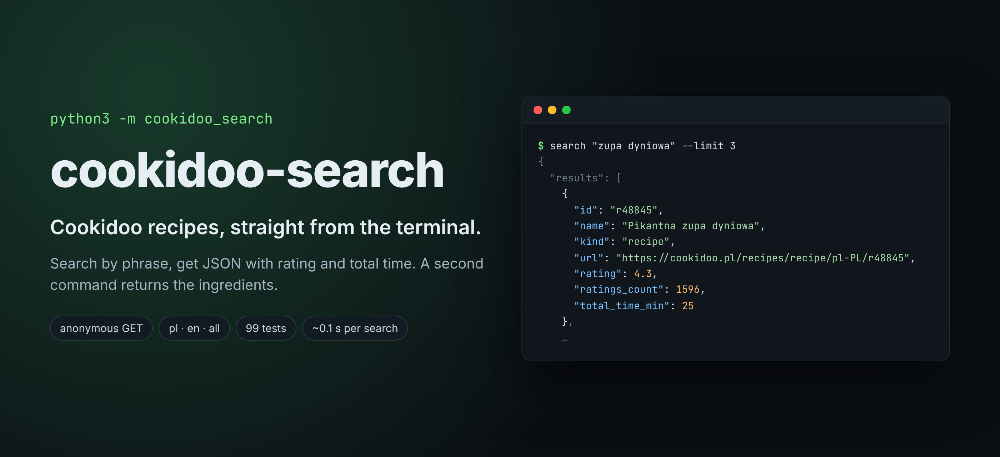
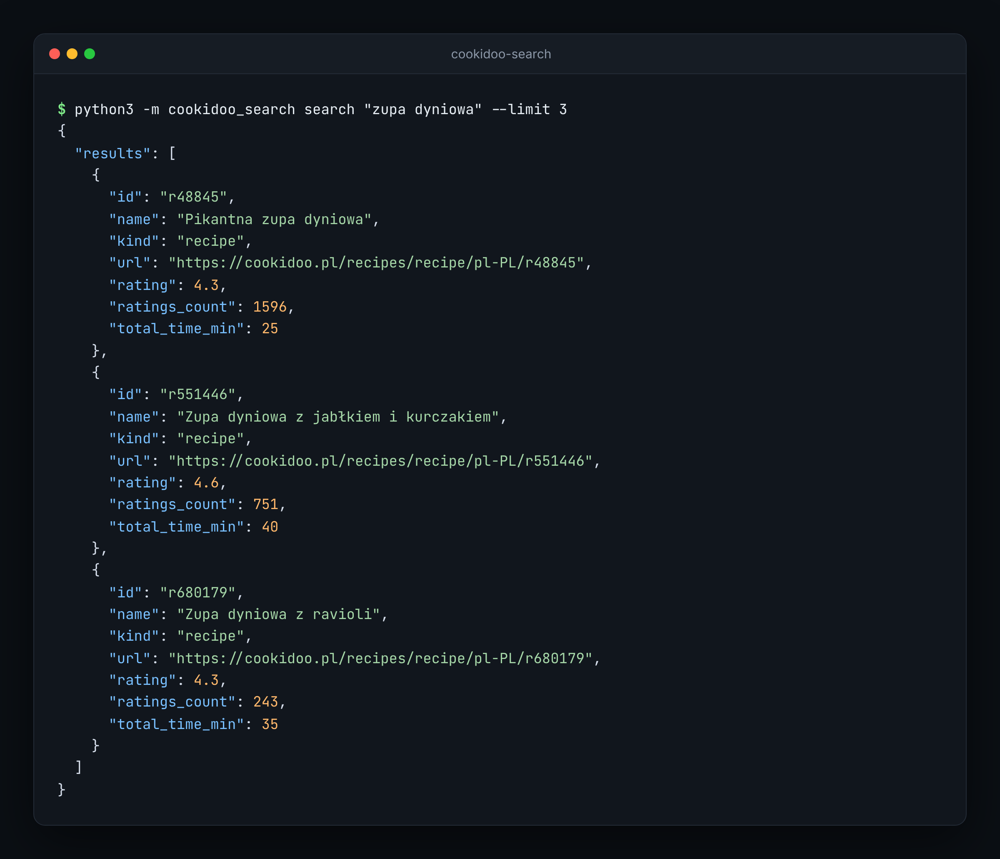
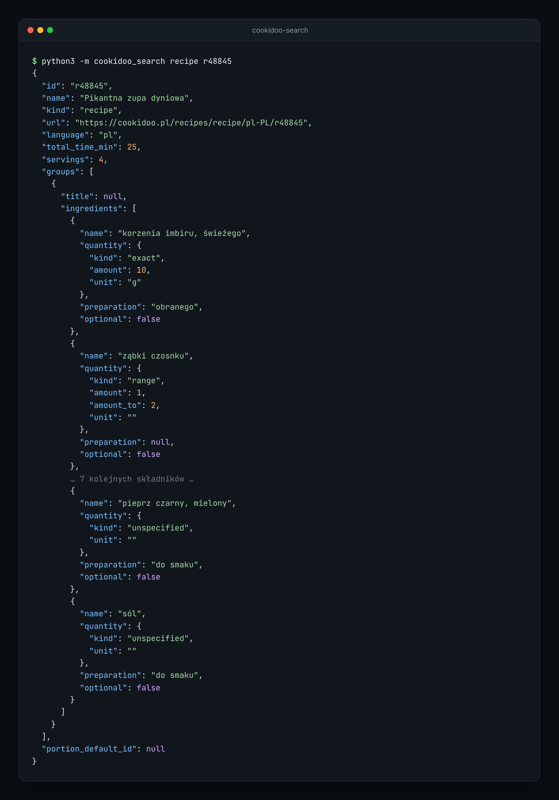
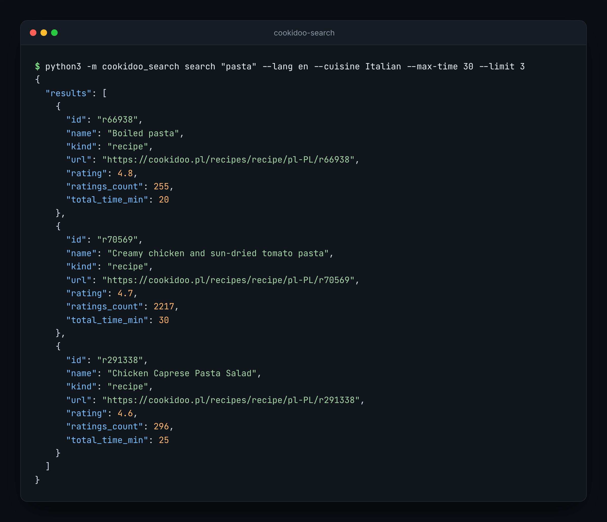
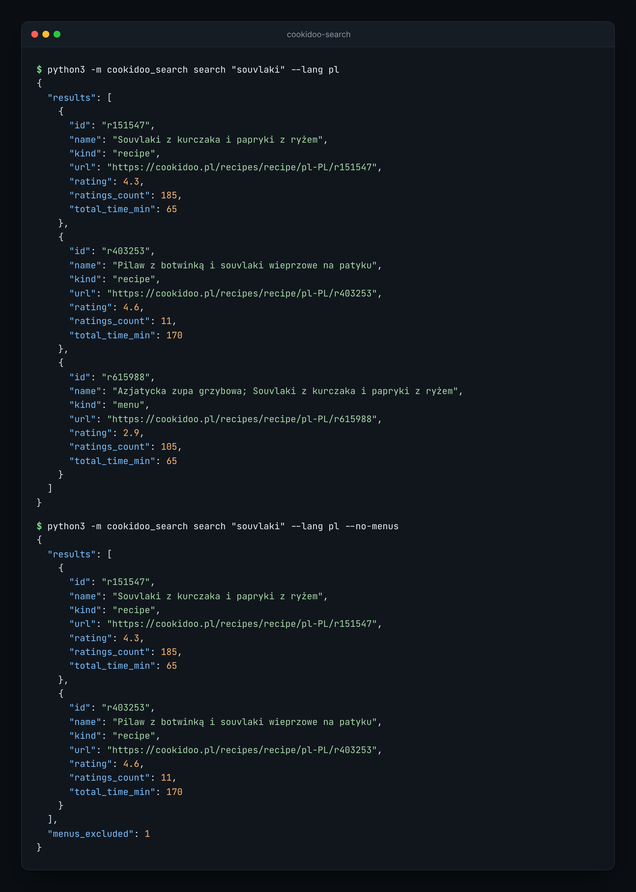
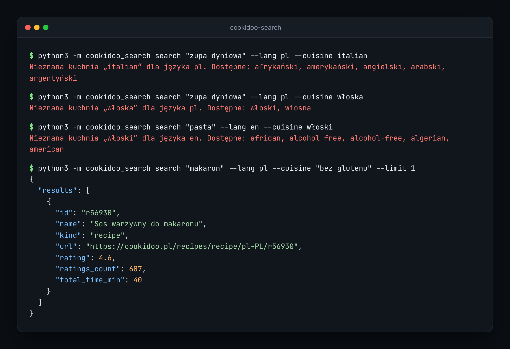
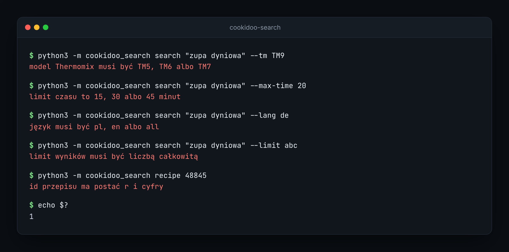
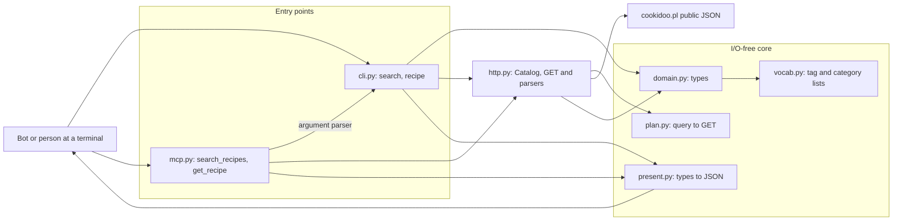

<p align="center"><a href="./README.md">PL</a> | <strong>EN</strong></p>

<p align="center">
  
</p>

<h1 align="center">cookidoo-search</h1>

<h3 align="center">Search Cookidoo recipes from the command line. Type a phrase, get JSON back.</h3>

<p align="center">
  <em>My kitchen bot used to click through the website in a browser. Now it runs one command and has the answer in about 0.1 s.</em>
</p>

<p align="center">
  
  
  
  
  
  
</p>

---

## Contents

- [About](#about)
- [Screenshots](#screenshots)
- [Using it through a bot](#using-it-through-a-bot)
- [Source code](#source-code)
- [Stack](#stack)
- [Features](#features)
- [Architecture](#architecture)
- [Numbers](#numbers)
- [Contact](#contact)

---

## About

Cookidoo is the recipe platform behind the Thermomix, and it has no public API or MCP server. My kitchen bot had to log in through a browser, type a phrase into the search box and read results off the screen. It worked, but it was slow and expensive.

I built cookidoo-search to replace that with a single command. Give it a phrase and it prints JSON with each recipe's name, link, star rating, number of ratings and total time. A second command returns the full ingredient list for one recipe, so the bot can check what it can cook from the fridge.

The tool is read only. It sends anonymous GET requests to cookidoo.pl and never writes anything to an account. Before writing any code, I compared a paid account with anonymous reads on 10 phrases. Eight result lists matched exactly. In the other two the account showed one extra portion-size variant, and that variant still opens anonymously by id.

---

## Screenshots

| Search: 3 hits with rating and time, as JSON | Recipe: 11 ingredients, ranges and "to taste" |
|:---:|:---:|
|  |  |

| English recipes, Italian cuisine, 30 minutes max | Menus get `kind: "menu"`, and `--no-menus` drops them |
|:---:|:---:|
|  |  |

| Unknown cuisine: an error with suggestions, before any request | Bad arguments get Polish messages and exit code 1 |
|:---:|:---:|
|  |  |

---

## Using it through a bot

You don't have to run cookidoo-search by hand in a terminal. You can put it in a bot's instructions instead. I added it to my kitchen bot's instructions, and now I just message the bot. It's an AI assistant that can run programs on a computer, so it runs the search and reads the results itself.

Two requests I send it:

> I feel like something Asian, maybe noodles. Make me a list.

> I've got chicken, peppers, an onion and rice in the fridge. What can I cook?

When I name a dish, the bot searches by cuisine, category and keywords, in Polish and in English. It replies with five recipes, each with a link, star rating, number of ratings and total time. Rating sets the order, and the bot weighs how many people rated. A 4.8 from a handful of ratings ranks below a 4.7 from hundreds.

When I list ingredients, the bot searches for them. It then fetches the full ingredient list of each candidate and compares it with mine. Every recipe in the reply says how many of its ingredients I have, like 6/8, and what I'm missing. Salt, pepper, oil and water count as stocked. A recipe that lacks its main ingredient gets dropped. Best match goes first, then rating.

---

## Source code

> The source code is private. This repo only describes the project and shows it running.

---

## Stack

### Core

```
Python 3.12+                // standard library only, zero dependencies
dataclasses + union types   // invalid state can't be built: Exact(0) or language "de" fail in the constructor
mypy --strict               // 19 files, 0 errors
```

### Input and output

```
urllib.request              // the only network adapter, GET only, 20 s socket timeout
argparse                    // search and recipe subcommands, Polish error messages
json                        // result on stdout, error on stderr, exit code 1
```

### Tests

```
unittest                    // 99 tests, 97 of them offline
cookidoo.pl fixtures        // 4 saved JSON responses: one search, three recipes
```

---

## Features

### Search

- **Polish or English.** `--lang pl`, `en` or `all`. The default `all` matches the site's "All" filter.
- **Filters.** Thermomix model (`--tm TM5|TM6|TM7`), max total time (`--max-time 15|30|45`), cuisine (`--cuisine`), category (`--category`).
- **Checked cuisine and category names.** The package ships 76 Polish tags, 103 English ones and 20 categories. Multi-word names like "gluten free" work. An unknown name fails with a Polish error and a few suggestions before any request goes out. A typo gets an error, not an empty list.
- **Menus flagged.** Cookidoo sometimes lists a set of dishes under one id. Every hit has a `kind` field: `menu` when the title contains a semicolon, `recipe` otherwise. `--no-menus` removes the menus and reports how many in `menus_excluded`.
- **Paging.** `--limit` from 1 to 50 and `--page` starting at 0.
- **Result fields.** Each hit has id, name, kind, link, rating, rating count and minutes.

### Recipe

- **Ingredient groups.** A recipe with sections, such as "Sauce", keeps them.
- **Three kinds of quantity.** Exact (`750 g`), a range (`1-2 cloves`), or none with a "to taste" note.
- **Preparation kept apart.** "peeled" or "cut into quarters" stays out of the ingredient name. Optional items have an `optional` flag.
- **Metadata.** Kind, recipe language, servings and total time.

### Safety

- **Read only.** The HTTP adapter accepts two paths and one method, GET. There is no type that could write anything.
- **No session.** The code has no login, no cookies and no account token.
- **Errors on stderr.** A bad argument prints a Polish message on stderr and exits with code 1. Stdout only ever carries JSON, so the bot has nothing to filter out.

### MCP layer

- **Two tools.** `search_recipes` and `get_recipe` take the same fields as the CLI flags and return the same dictionary. `exclude_menus` does what `--no-menus` does.
- **One core.** MCP goes through the same catalog as the CLI. There is no second HTTP client.

---

## Architecture

The core does no I/O. Only the HTTP adapter talks to the network. The CLI and MCP only know the `Catalog` protocol and the domain types, so tests swap in a fixture-backed catalog and never touch the network.



Search and recipe are separate calls on purpose. If search fetched ingredients too, one query would turn into a dozen requests. The bot fetches ingredients only for the recipes it cares about.

The tag and category lists are a frozen snapshot from 27 Nov 2026 that ships with the package. Nothing downloads them at runtime. The query types reject an unknown name, so it never reaches the HTTP adapter.

---

## Numbers

### Technical size

| Metric | Value |
|---|---|
| **Python lines in the package** | 1,625 (10 files) |
| **Test lines** | 2,079 (9 files) |
| **Tests** | 99, 97 of them offline |
| **mypy --strict** | 0 errors in 19 files |
| **Dependencies** | 0 |
| **Commits on main** | 28 |
| **Pull requests** | 11, all merged |
| **Search time** | median 0.11-0.12 s, max 0.22 s |
| **Recipe fetch time** | median 0.22 s, max 0.25 s |

Times cover the whole CLI process, from Python startup to printed JSON, 10 runs per command on 27 Nov 2026.

### Feature overview

| Area | Highlights |
|---|---|
| **Search** | pl, en, all, Thermomix model, time, checked cuisine and category, paging, `--no-menus` |
| **Recipe** | ingredient groups, exact amounts, ranges, "to taste", optional items |
| **Interfaces** | CLI with JSON on stdout, MCP tools on the same core |
| **Safety** | GET only, no session |

---

## Contact

| Platform | Link |
|---|---|
| **Email** | [wandrysiak.it@gmail.com](mailto:wandrysiak.it@gmail.com) |
| **GitHub** | [wandrysiak](https://github.com/wandrysiak) |

---

<p align="center">
  <strong>cookidoo-search</strong>, Cookidoo recipes in one command.
  <br/><br/>
  Wojciech Andrysiak
  <br/><br/>
  <sub>Unofficial project, not affiliated with Vorwerk. Cookidoo® and Thermomix® are trademarks of Vorwerk International AG.</sub>
</p>
