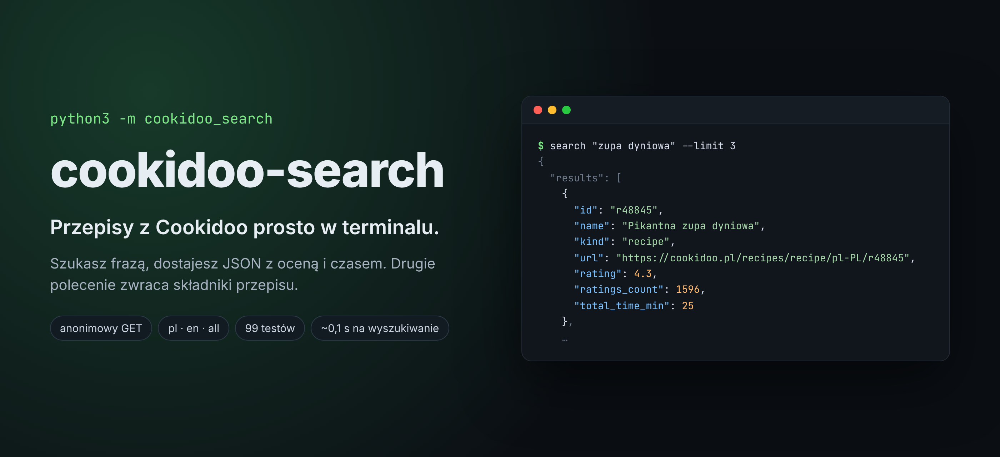
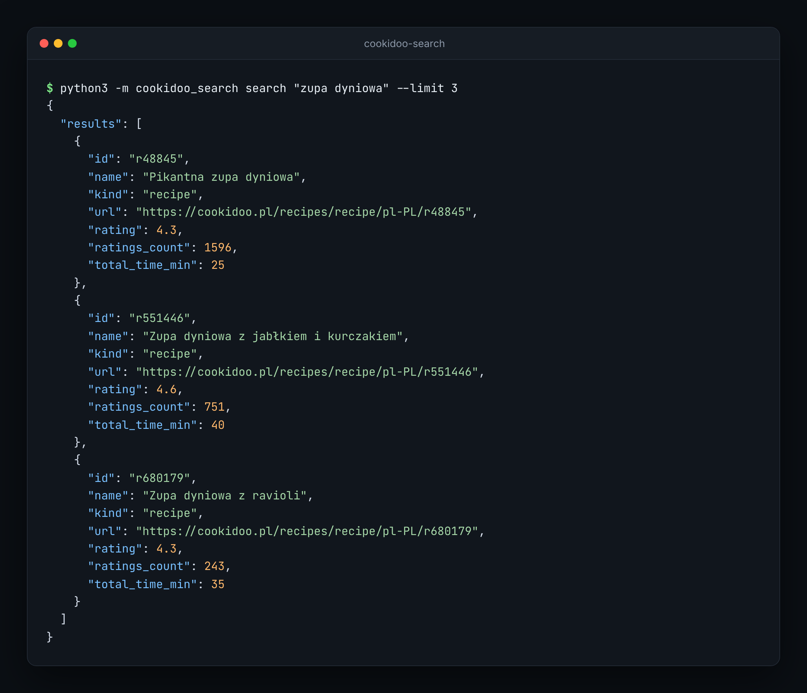
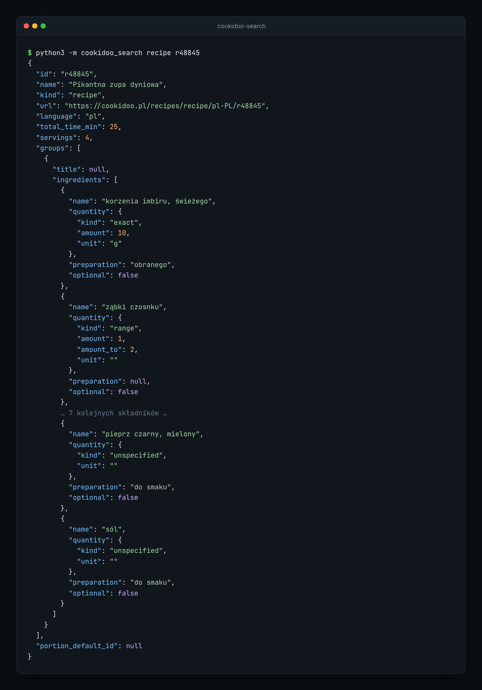
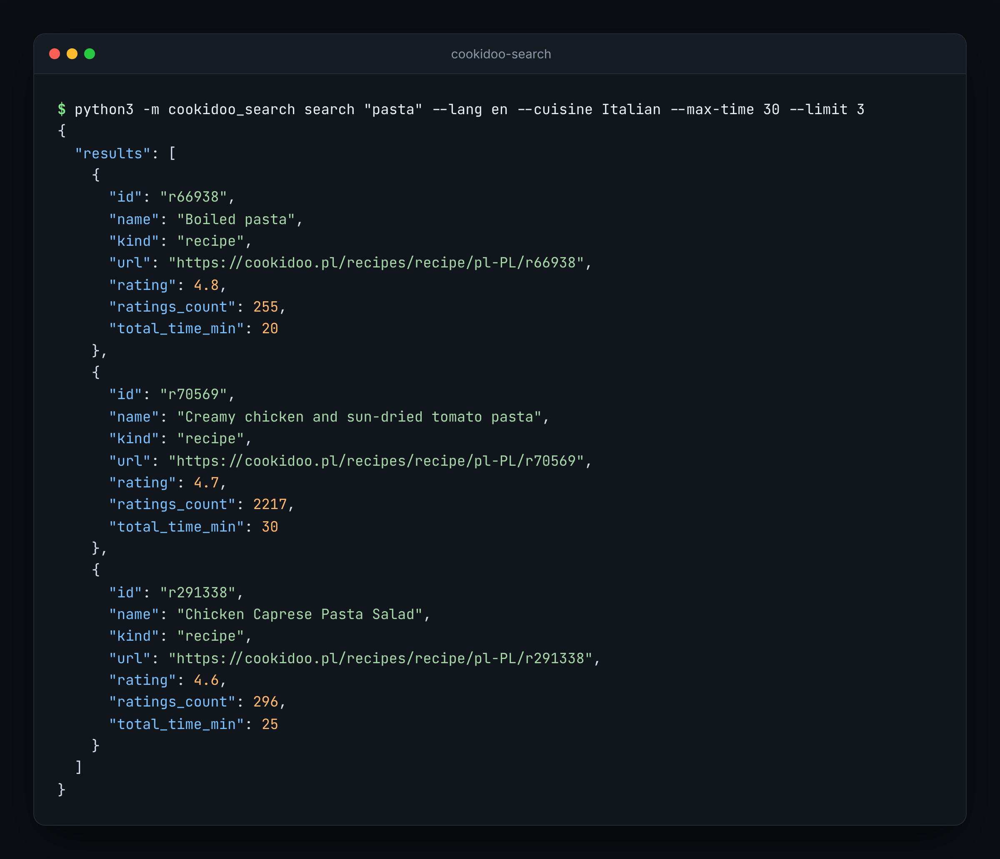
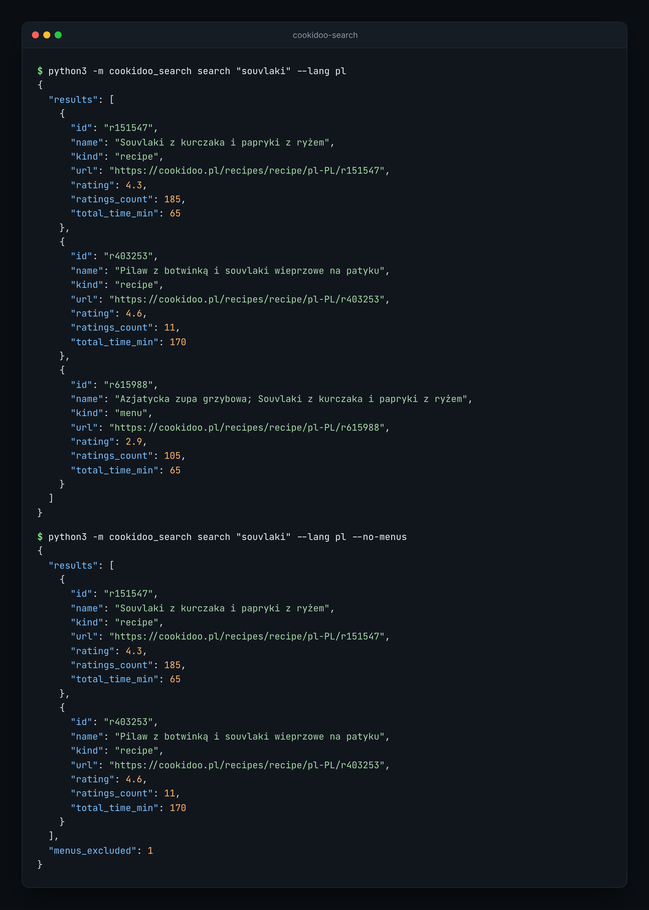
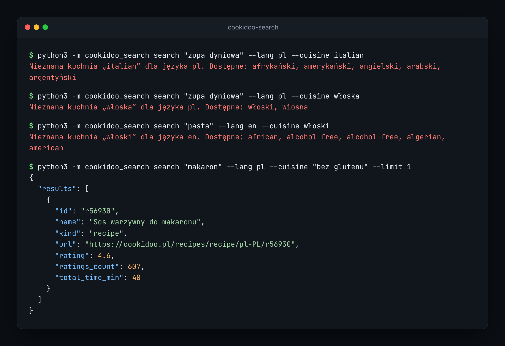
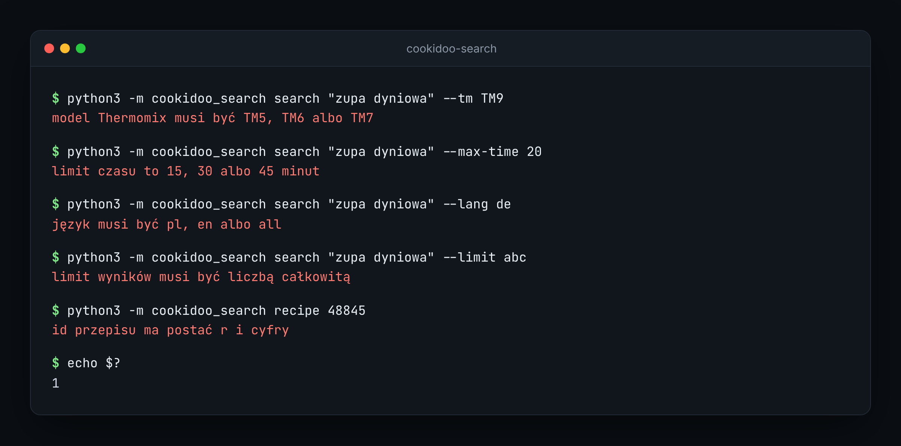
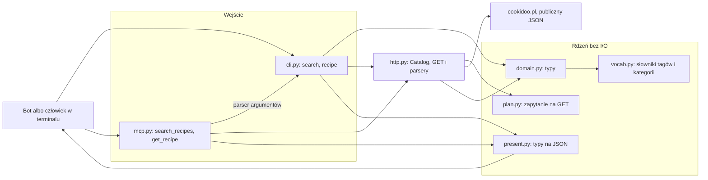

<p align="center"><strong>PL</strong> | <a href="./README.en.md">EN</a></p>

<p align="center">
  
</p>

<h1 align="center">cookidoo-search</h1>

<h3 align="center">Wyszukiwarka przepisów Cookidoo w terminalu. Wpisujesz frazę, dostajesz JSON.</h3>

<p align="center">
  <em>Bot kuchenny przestał klikać po stronie w przeglądarce. Teraz uruchamia jedno polecenie i ma wynik po około 0,1 s.</em>
</p>

<p align="center">
  
  
  
  
  
  
</p>

---

## Spis treści

- [O projekcie](#o-projekcie)
- [Screenshoty](#screenshoty)
- [Jak używam tego z botem](#jak-używam-tego-z-botem)
- [Kod źródłowy](#kod-źródłowy)
- [Stack](#stack)
- [Funkcje](#funkcje)
- [Architektura](#architektura)
- [Statystyki](#statystyki)
- [Kontakt](#kontakt)

---

## O projekcie

Cookidoo, serwis z przepisami do Thermomixa, nie ma publicznego API ani serwera MCP. Mój bot kuchenny szukał więc przepisów przez zalogowaną przeglądarkę: otwierał stronę, wpisywał frazę i czytał wyniki z ekranu. Działało, ale było wolne i drogie.

Zbudowałem cookidoo-search, żeby to samo załatwiało jedno polecenie. Podajesz frazę i dostajesz JSON z nazwą, linkiem, oceną, liczbą ocen i czasem przygotowania. Drugie polecenie zwraca pełną listę składników wybranego przepisu, więc bot sprawdzi, co ugotuje z tego, co ma w lodówce.

Narzędzie tylko czyta. Wysyła anonimowe żądania GET na cookidoo.pl i niczego nie zapisuje na koncie. Zanim napisałem kod, porównałem konto z abonamentem z odczytem anonimowym na 10 frazach. Osiem list wyszło identycznych. W dwóch konto pokazało po jednym dodatkowym wariancie porcji, a ten i tak otwiera się anonimowo po id.

---

## Screenshoty

| Wyszukiwanie: 3 wyniki z oceną i czasem w JSON | Przepis: 11 składników, zakresy i „do smaku” |
|:---:|:---:|
|  |  |

| Przepisy angielskie, kuchnia włoska, do 30 minut | Menu oznaczone `kind: "menu"`, a `--no-menus` je wycina |
|:---:|:---:|
|  |  |

| Nieznana kuchnia: błąd z podpowiedziami, zanim pójdzie zapytanie | Błędy argumentów po polsku, kod wyjścia 1 |
|:---:|:---:|
|  |  |

---

## Jak używam tego z botem

Z cookidoo-search nie trzeba korzystać ręcznie w terminalu. Wystarczy dopisać narzędzie do instrukcji bota. Ja dopisałem je mojemu botowi kuchennemu i teraz po prostu do niego piszę. Bot to asystent AI, który może uruchamiać programy na komputerze, więc sam odpala wyszukiwanie i czyta wyniki.

Piszę mu na przykład:

> Mam ochotę na coś azjatyckiego, jakiś makaron. Przygotuj mi listę.

> Mam w lodówce kurczaka, paprykę, cebulę i ryż. Co z tego zrobię?

Przy ochocie na danie bot szuka po kuchni, kategorii i słowach kluczowych, po polsku i po angielsku. Odpowiada listą pięciu przepisów z linkiem, oceną, liczbą ocen i czasem. Kolejność ustala ocena, ale bot bierze pod uwagę liczbę ocen. Przepis z oceną 4,8 przy kilku głosach ląduje niżej niż 4,7 przy setkach.

Przy składnikach bot szuka po tym, co podałem. Potem pobiera pełne listy składników kandydatów i porównuje je z moją listą. Przy każdym przepisie pisze, ile jego składników mam, na przykład 6/8, i czego brakuje. Sól, pieprz, olej i wodę uznaje za dostępne. Przepis bez głównego składnika odpada. Najpierw liczy się dopasowanie, potem ocena.

---

## Kod źródłowy

> Kod źródłowy jest prywatny. Tutaj jest tylko opis projektu i zrzuty z działania.

---

## Stack

### Rdzeń

```
Python 3.12+                // sama biblioteka standardowa, zero zależności
dataclasses + unie typów    // Exact(0) albo język "de" odpadają już w konstruktorze
mypy --strict               // 19 plików, 0 błędów
```

### Wejście i wyjście

```
urllib.request              // jedyny adapter sieciowy, tylko GET, limit gniazda 20 s
argparse                    // podkomendy search i recipe, komunikaty błędów po polsku
json                        // wynik na stdout, błąd na stderr, kod wyjścia 1
```

### Testy

```
unittest                    // 99 testów, 97 działa bez sieci
fixtures z cookidoo.pl      // 4 zapisane odpowiedzi JSON: wyszukiwanie i 3 przepisy
```

---

## Funkcje

### Wyszukiwanie

- **Fraza po polsku albo po angielsku.** `--lang pl`, `en` albo `all`. Domyślne `all` daje to samo, co strona z filtrem „Wszystkie”.
- **Filtry.** Model Thermomixa (`--tm TM5|TM6|TM7`), maksymalny czas (`--max-time 15|30|45`), kuchnia (`--cuisine`), kategoria (`--category`).
- **Słowniki kuchni i kategorii.** W pakiecie jest 76 tagów polskich, 103 angielskie i 20 kategorii. Nazwy wielowyrazowe, na przykład „bez glutenu”, też przechodzą. Nieznana nazwa daje polski błąd z podpowiedziami, zanim pójdzie zapytanie. Literówka kończy się błędem, a nie pustą listą.
- **Menu osobno.** Cookidoo zwraca czasem zestaw dań pod jednym id. Każde trafienie ma pole `kind`: `menu`, gdy w tytule jest średnik, albo `recipe`. Flaga `--no-menus` wycina menu i podaje ich liczbę w `menus_excluded`.
- **Stronicowanie.** `--limit` od 1 do 50 i `--page` od 0.
- **Pola wyniku.** Każde trafienie ma id, nazwę, rodzaj, link, ocenę, liczbę ocen i czas w minutach.

### Przepis

- **Składniki w grupach.** Przepis z sekcjami, na przykład „Sos”, zachowuje podział.
- **Ilość ma trzy postacie.** Dokładna (`750 g`), zakres (`1-2 ząbki`) albo brak ilości z dopiskiem „do smaku”.
- **Dopisek przygotowania osobno.** „obranego” albo „pokrojonej w ćwiartki” nie miesza się z nazwą składnika. Pozycje opcjonalne mają flagę `optional`.
- **Metadane.** Rodzaj (`kind`), język przepisu, liczba porcji i łączny czas.

### Bezpieczeństwo

- **Tylko odczyt.** Adapter HTTP przyjmuje dwie ścieżki i jedną metodę: GET. Nie ma typu, który mógłby coś zapisać.
- **Bez sesji.** W kodzie nie ma logowania, ciasteczek ani tokenu konta.
- **Błędy po polsku.** Zły argument daje polski komunikat na stderr i kod 1. Na stdout trafia tylko JSON, więc bot nie musi niczego odsiewać.

### Warstwa MCP

- **Dwa narzędzia.** `search_recipes` i `get_recipe` przyjmują te same pola, co flagi CLI, i zwracają ten sam słownik. Odpowiednikiem `--no-menus` jest `exclude_menus`.
- **Jeden rdzeń.** MCP woła ten sam katalog, co CLI, bez drugiego klienta HTTP.

---

## Architektura

Rdzeń nie robi I/O. Do sieci wychodzi tylko adapter HTTP. CLI i MCP znają tylko protokół `Catalog` i typy domenowe, więc testy podstawiają katalog z fixture i nie wychodzą w sieć.



Wyszukiwanie i przepis to dwa osobne wywołania. Wyszukiwanie nie dociąga składników, bo z jednego zapytania zrobiłoby się kilkanaście żądań. Bot pobiera składniki tylko dla przepisów, które go interesują.

Słowniki tagów i kategorii leżą w pakiecie jako zamrożony odczyt z 27.11.2026. Pakiet nie pobiera ich z sieci. Nazwę sprawdzają typy zapytania, więc zła nazwa nie dociera do adaptera HTTP.

---

## Statystyki

### Złożoność techniczna

| Metryka | Wartość |
|---|---|
| **Linie Pythona w pakiecie** | 1 625 (10 plików) |
| **Linie testów** | 2 079 (9 plików) |
| **Testy** | 99, w tym 97 bez sieci |
| **mypy --strict** | 0 błędów w 19 plikach |
| **Zależności** | 0 |
| **Commity na main** | 28 |
| **Pull requesty** | 11, wszystkie zmergowane |
| **Czas wyszukiwania** | mediana 0,11-0,12 s, max 0,22 s |
| **Czas pobrania przepisu** | mediana 0,22 s, max 0,25 s |

Czasy to cały proces CLI, od startu Pythona do wypisania JSON, po 10 pomiarów na polecenie, 27.11.2026.

### Przegląd funkcji

| Kategoria | Najważniejsze |
|---|---|
| **Wyszukiwanie** | pl, en, all, model Thermomixa, czas, kuchnia i kategoria ze słownika, stronicowanie, `--no-menus` |
| **Przepis** | grupy składników, ilość dokładna, zakres, „do smaku”, pozycje opcjonalne |
| **Interfejsy** | CLI z JSON na stdout, narzędzia MCP na tym samym rdzeniu |
| **Bezpieczeństwo** | tylko GET, bez sesji |

---

## Kontakt

| Platforma | Link |
|---|---|
| **Email** | [wandrysiak.it@gmail.com](mailto:wandrysiak.it@gmail.com) |
| **GitHub** | [wandrysiak](https://github.com/wandrysiak) |

---

<p align="center">
  <strong>cookidoo-search</strong>, przepisy z Cookidoo w jednym poleceniu.
  <br/><br/>
  Wojciech Andrysiak
  <br/><br/>
  <sub>Projekt nieoficjalny, niezwiązany z Vorwerk. Cookidoo® i Thermomix® są znakami towarowymi Vorwerk International AG.</sub>
</p>
